# Fleet API: one service to configure, version and deploy stations and servers

- **Status:** Proposed
- **Deciders:** Mateo
- **Date:** November 2026
- **Issue:** pyronear/pi-manager-template#109 (epic pyronear/roadmap#14)
- **Supersedes in part:** `Mender vs Ansible` (Ansible stays, but it is driven by the Fleet API)

## 1. Context

Today a deployment is: edit YAML in a private country repo (`pi-manager-fr`, `pi-manager-chile`), then run an Ansible playbook **from someone's laptop**, inside the `pyro-ansible` container. Each laptop has its own checkout of the repo, and that checkout is what gets deployed.

This causes three families of problems.

### 1.1 The same station is described in several places

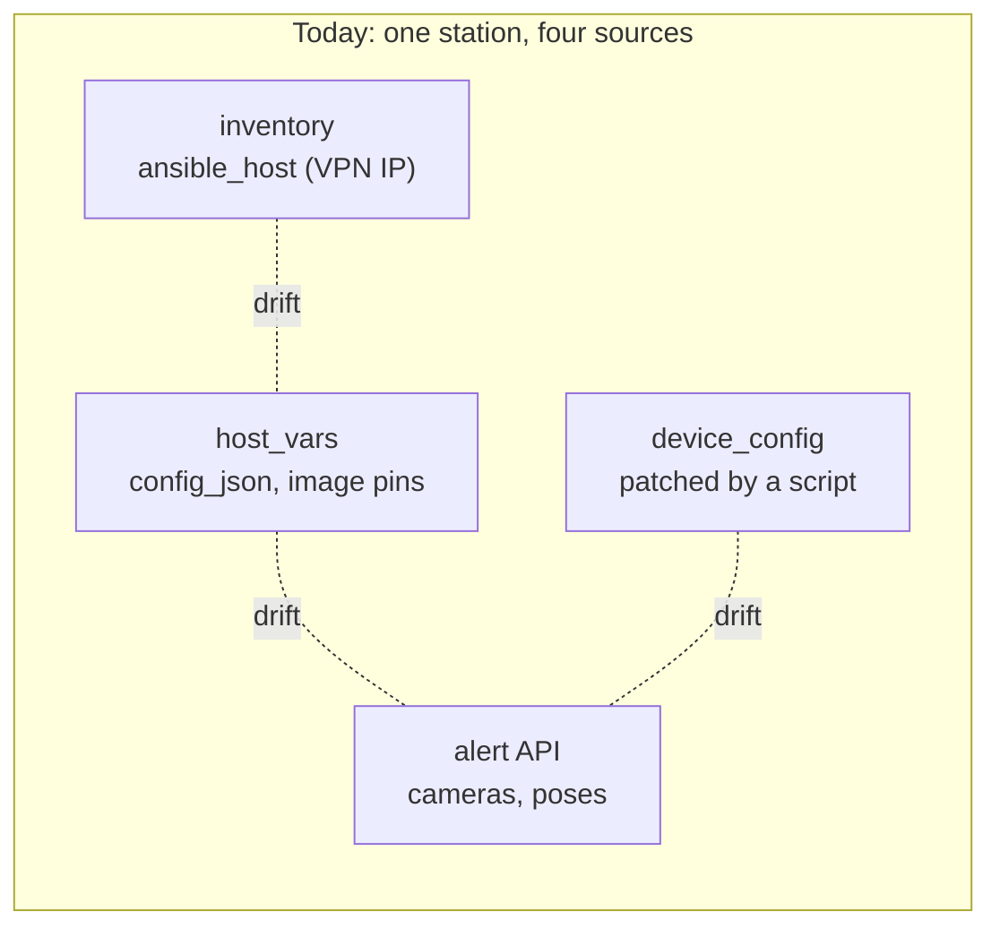

These sources drift apart:

- a camera in `config_json` that does not exist in the API (snow-valley);
- inventory entries pointing at another site's Pi after the VPN renumbering;
- `device_config` applied by hand.

### 1.2 What is deployed is not what is in the repo

The real state of the fleet is whatever the last person deployed **from their own laptop**, and nothing guarantees that it matches `main`:

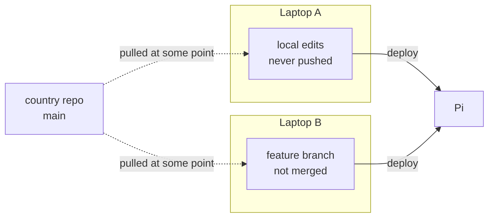

- **Local changes not pushed.** Someone edits `host_vars` and deploys. The Pi now runs a config that exists nowhere in the repo. The next person who deploys from `main` silently reverts it.
- **Deploying from a branch.** A Pi is updated from a branch that is not merged. The repo says one thing, the Pi runs another. Pins written on a branch are wiped by the next `git reset` or `pull`.
- **Nobody knows.** There is no log of who deployed what, when, from which commit. Devices get updated without the rest of the team being aware of it.
- **Two people at the same time.** Nothing stops two people from deploying to the same Pi at the same time, from two different checkouts.

### 1.3 Other problems

- Nobody can tell which version runs on which station.
- Deployments are slow and manual.
- During fire season, server updates must not cut the service during the day.

### 1.4 What we want

- **One place** that says what each station should run, shared by the whole team.
- **Every deployment recorded**: who, what, when, on which device, with which result.
- **One deployment at a time per device**, whoever launches it.
- **The running version of each device** visible to everyone.

## 2. Decision

We build a custom **Fleet API** (FastAPI + Postgres) with a small frontend and a worker that runs the existing Ansible roles.

| Topic | Decision |
|---|---|
| Source of truth | Read as much as possible from the **alert API** (cameras, poses, last seen). The Fleet API stores only what the alert API does not have (section 3.1). The running version is reported by the Pi to the Fleet API, not through the alert API heartbeat. |
| Secrets | Stored **encrypted in the database**, with a key per instance (env var). Never returned in clear by the API or the frontend. |
| Security | Reachable through the VPN only, with authentication and an audit log of every action. |
| Instances | **One instance per country** (France, Chile, ...). Anyone can also run one **locally** with the same `docker compose`. A Pi has **one owner instance** at a time (section 4.2). |
| Execution | **Ansible stays.** The roles in this repo are embedded in the worker image. |
| Update model | **Push** to decide, **local execution** on the Pi (`pyro-update`) of a complete **release bundle**, with local rollback. The Pi **reports the result back**, with a local status file as fallback. |
| Rollout | **One wave per night**, each wave observed for a full day (section 4.7). |
| Auto mode | Optional. A Pi in auto mode only takes releases **promoted** by a campaign (section 5). |
| Tooling | Custom. No Semaphore, AWX, Mender or Yocto for now. |

Consequences:

- `pi-manager-template` becomes this product.
- `pi-manager-fr` and `pi-manager-chile` are imported into their instance's database, then retired once everything they are used for is replaced (section 8, step 7).

## 3. Architecture

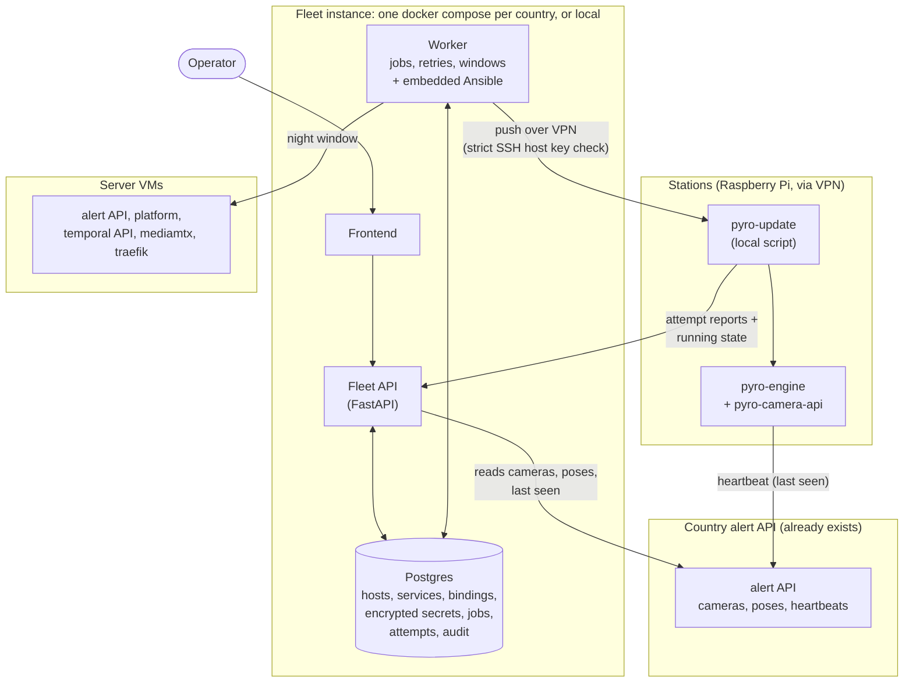

Two key points:

- **Decisions go down by push** (worker → Ansible → Pi), and the Pi reports what happened.
- **What actually runs is reported by `pyro-update`** to the Fleet API (running bundle and image digests), at boot, after each attempt and once a day. A deployment that "succeeded" is never used as proof of the running version. The engine heartbeat to the alert API stays as it is and only tells whether the Pi is alive.

### 3.1 Who owns which field

| Data | Owner | Notes |
|---|---|---|
| Organizations, cameras, poses | alert API | The Fleet API reads them, never keeps an editable copy. |
| Last seen | alert API (heartbeat) | Unchanged. Shown with its observation time. |
| Running bundle and image digests | Fleet API (reported by `pyro-update`) | Section 4.5. Shown with its observation time. Missing data is shown as **unknown**. |
| Host identity: name, VPN IP, SSH host key | Fleet API | The SSH key is enrolled at station setup (section 7). |
| Camera binding: alert API camera id ↔ host, camera LAN IP, adapter, camera type | Fleet API | This is the hardware side that the alert API does not know. |
| Camera and API credentials | Fleet API (encrypted) | |
| Engine parameters (non-camera settings) | Fleet API | |
| Desired version and mode, per service | Fleet API | |
| Campaigns, jobs, attempts, audit | Fleet API | |

The engine configuration (`config_json`, `credentials.json`, `.env`, `device_config`) is **rendered** from these two sources when a job starts, and frozen in the release bundle (section 4.1). If an alert API record a job needs has disappeared, the job fails without retry ("invalid config"). If the alert API cannot be reached, the job waits.

### 3.2 Data model (first sketch)

A **host** is a machine (a Pi or a VM). A **service** is one versioned thing running on a host: a Pi runs one `engine` service, a VM can run `alert_api`, `platform`, `mediamtx`, etc. Versions and deployments target services, not hosts.

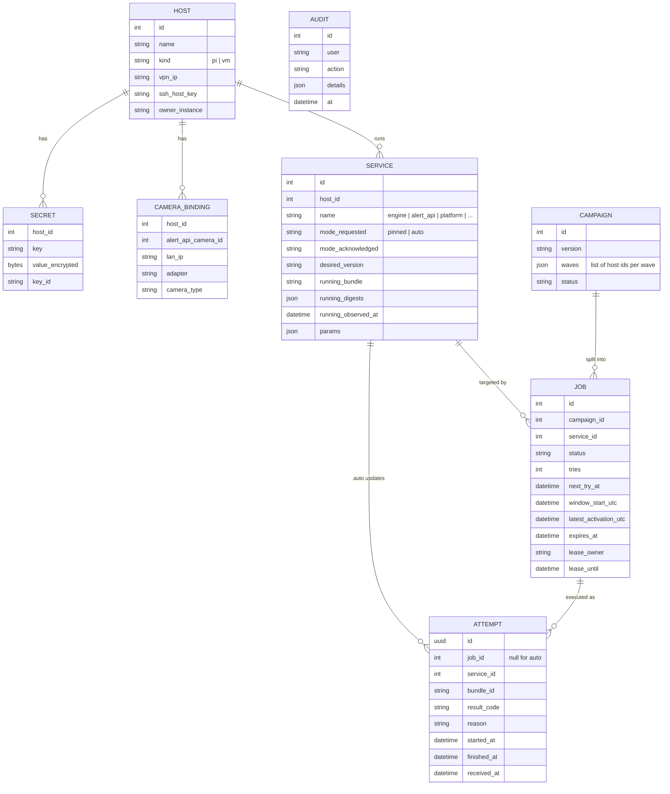

## 4. Updating an engine

### 4.1 The release bundle

The engine is not just one image. Today the `engine` role checks out the `pyro-engine` repo (compose file and scripts) independently of the image tag, pulls **two** images (`pyro-engine` and `pyro-camera-api`), then rewrites credentials and `.env`. Rolling back only the image would leave a mixed release.

So the unit we deploy and roll back is a **bundle**:

```
/opt/pyro/releases/<bundle_id>/
  manifest.json      pyro-engine and pyro-camera-api image digests,
                     pyro-engine git revision, config revision, pyro-update version
  docker-compose.yml
  scripts/
  config/            config_json, credentials.json, .env (0600)
/opt/pyro/current -> releases/<bundle_id>
```

- **Ansible only stages** a new bundle next to the current one. It never touches the running release.
- **`pyro-update` activates** it by switching the `current` symlink and restarting the containers from the bundle, using **image digests**, not tags.
- **The previous bundle and its images are kept** and excluded from pruning, so a rollback is a symlink switch and a restart, with no download.
- **A config-only change** (new camera, new parameter) is a new bundle too, with the same activation and rollback.

### 4.2 One owner per Pi

A laptop instance and the country's server instance have separate databases. Without a rule, both could push to the same Pi.

- The Pi stores its **owner instance** in `/var/lib/pyro-update/owner`, and every request is checked against it. A request from another instance is refused with "owned by X".
- **Taking over** a Pi is an explicit, audited action (for example a technician's laptop during an intervention). Giving it back is explicit too. The previous owner shows the Pi as "owned by another instance".
- A **local lock** on the Pi covers staging, activation, mode changes and rollback. Only one operation runs at a time.
- Each execution has an **attempt UUID**. Sending an attempt that was already accepted returns its current status instead of starting it again.

This is what keeps local instances from bringing back the problems of section 1.2: a laptop can only deploy to a Pi it has explicitly taken over, the takeover is visible from the country's server instance, and two instances can never update the same Pi at the same time.

### 4.3 Push, then local execution

The worker does not stay connected during the update. It stages the bundle, then starts `pyro-update` detached (`systemd-run`). If 4G drops in the middle, the Pi still finishes or rolls back on its own.

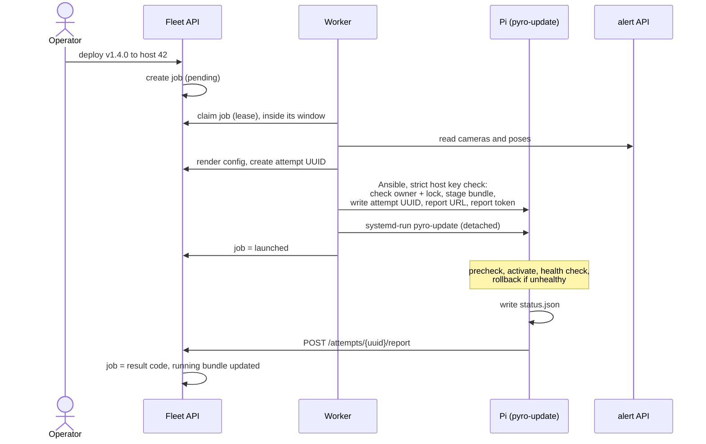

### 4.4 What `pyro-update` does on the Pi

Every phase is written to disk **before** it starts, so a reboot or a power cut in the middle can be recovered.

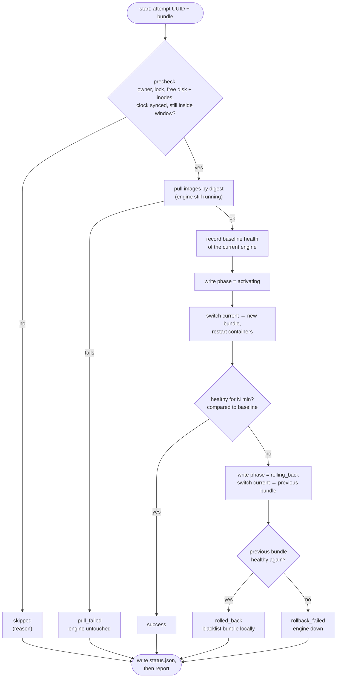

**Health check.** "Healthy" means more than "container running": every bound camera returns frames and the engine processes them. It is compared to a **baseline** taken just before the update. A camera that was already broken before the update does not make the new release fail. At night, cameras may switch to infrared and the engine may process fewer frames, so the night thresholds must be set accordingly. The health check never depends on the alert API: if the country API is down, that is not a reason to roll back.

**Recovery at boot.** A systemd unit runs `pyro-update --recover` at boot:

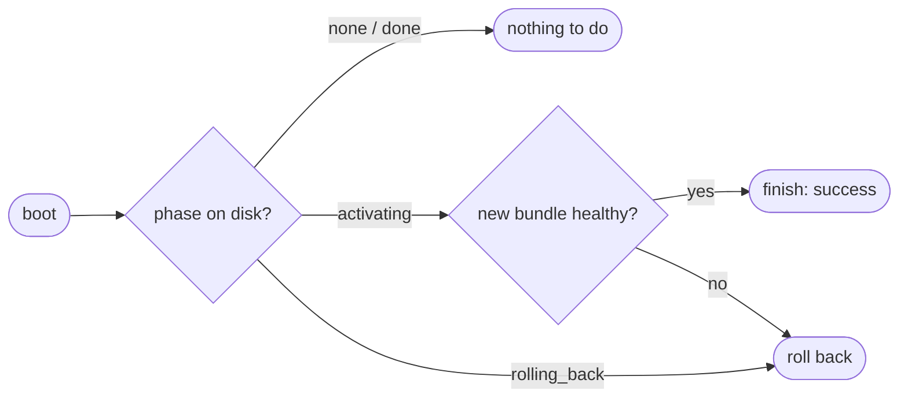

**Nightly reboot and watchdogs.** Pis without a watchdog reboot at 00:00 (`roles/engine_cron`), and hardware watchdogs (Pi Zero, Shelly) can cut the power if the engine looks dead. The update window must not overlap the 00:00 reboot, and `pyro-update` must tell the watchdog that a maintenance is running, for a bounded time.

**Disk full.** The precheck requires enough free space and inodes for the new images and the status file. If `status.json` cannot be written, the report is still sent and says so.

### 4.5 Reporting to the Fleet API

`pyro-update` sends two kinds of reports, through the same outbox:

| Report | When | Content |
|---|---|---|
| **Running state** | at boot, after each attempt, once a day | running bundle id, image digests actually running, `pyro-update` version |
| **Attempt result** | at the end of each attempt | result code, reason, bundle, timestamps |

The running version does not go through the alert API heartbeat: sending it every minute is useless, and the alert API does not need it. With these reports, the Fleet API knows the running version without any change to the engine or the alert API.

The daily running state report also catches **manual changes**: if the image digests actually running differ from the bundle `pyro-update` activated (someone ran `docker compose` by hand), the Pi is flagged as **drifted** in the frontend.

The rest of this section is about attempt results.

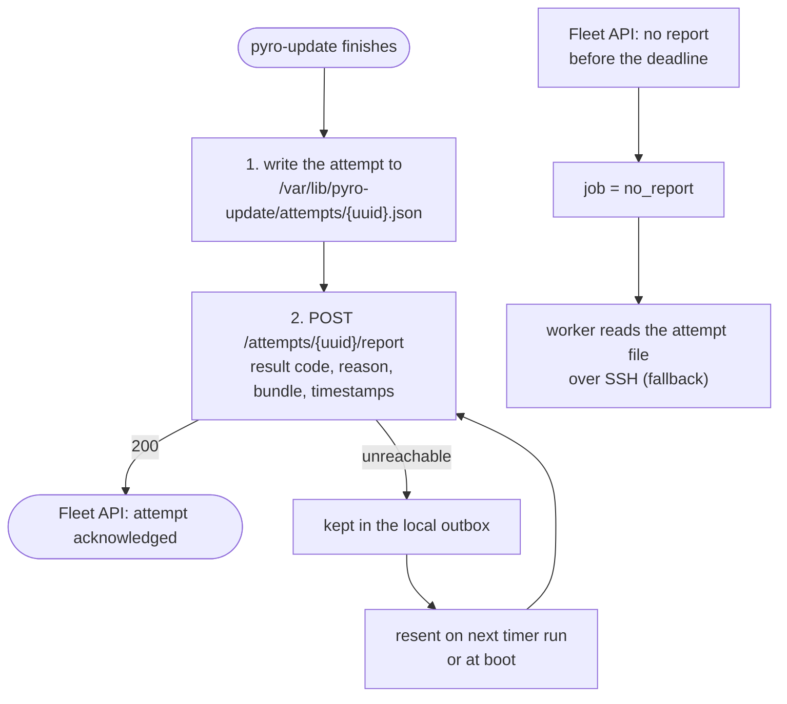

- **One file per attempt**, kept until the Fleet API acknowledges it. A new attempt never overwrites an older one.
- **The report URL and token are stored with each attempt**, so rotating them later does not lose pending reports.
- **The report token can only report results for this Pi's own attempts.** It cannot start a deployment, read a secret or report for another Pi.
- **Reports are idempotent.** A report received twice changes nothing. A late report never overwrites a newer state.
- **The callback is the fast path, the attempt file is the truth.** If the callback never arrives, the state is late, never wrong.

| Result code | Meaning | Engine afterwards |
|---|---|---|
| `success` | New bundle running and healthy | new version |
| `pull_failed` | Images not downloaded (network, disk full) | old version, never stopped |
| `rolled_back` | Health check failed, rollback succeeded (+ reason) | old version |
| `rollback_failed` | Health check failed **and** rollback failed | **down: immediate alert** |
| `skipped` | Precheck refused (owner, lock, disk, clock, window), bundle blacklisted, or already up to date | unchanged |

`rollback_failed` sends a notification immediately. But a Pi that loses power during activation may never report at all, so **a Pi that stays unknown after its deadline also triggers an alert**, based on its last seen time.

Example attempt file:

```json
{
  "attempt": "6f1c2a3e-8b0d-4e55-9a51-2f6b7c9d0e11",
  "job_id": 1234,
  "bundle": "engine-v1.4.0-cfg87",
  "previous_bundle": "engine-v1.3.2-cfg85",
  "result": "rolled_back",
  "reason": "no frames from camera 2 after 10 min (baseline: 4/4 cameras)",
  "trigger": "push",
  "started_at": "2026-11-08T01:12:03Z",
  "finished_at": "2026-11-08T01:24:41Z"
}
```

### 4.6 Jobs: retries, windows, deadlines

Offline Pis are a normal state. A job waits for its Pi instead of failing.

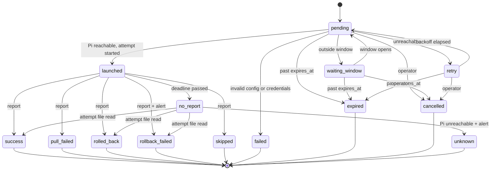

Rules:

- **Durable claiming.** A worker claims a job with a lease. If the worker dies, the lease expires and the job is picked up again. Before launching a new attempt, the worker first checks on the Pi whether the previous attempt was already accepted.
- **One job at a time per service**, and one operation at a time per host (the Pi's local lock, a host lock for VMs).
- **Windows are in the country's time zone**, stored as concrete UTC times on each job, with a **latest activation time** that leaves enough time to roll back before the window closes. `pyro-update` checks the window again right before activating, and waits if its clock is not synchronized.
- **A late job never starts outside its window.** It waits for the next one, or expires.
- **Cancelling** only stops attempts that have not started. An update already running on a Pi finishes or rolls back.
- **Errors that cannot be fixed by waiting** (bad config, bad credentials) are not retried.

### 4.7 "Update all" means waves, one night each

Devices update at night, but a night-time health check only proves that the engine starts and grabs frames. Detection on daylight images, alerts, load and slow memory leaks only show up during the next day. So each wave is deployed at night and observed for a full day before the next one.

| When | What |
|---|---|
| Night 1 | Canary: 1 to 2 devices |
| Day 1 | Observation: heartbeat OK, no rollback, the engine processes frames and sends alerts normally |
| Night 2 | Wave of ~10% of the devices, or all the rest if the fleet is small |
| Day 2 | Observation |
| Night 3 | Rest of the fleet |

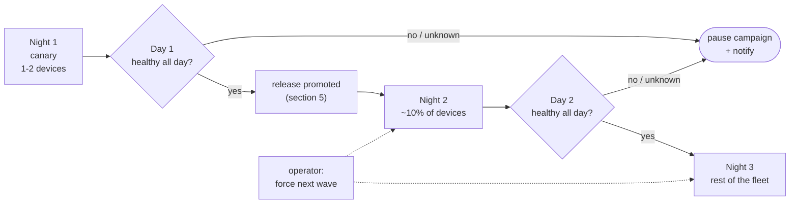

- A campaign is an **explicit list of waves**, each a fixed list of hosts. The membership is frozen when the campaign starts.
- **The next wave starts automatically** when the previous one was healthy for the whole day. **"Unknown" counts as a failure**: a wave with a Pi that never reported does not let the campaign continue.
- **The operator can force the next wave** (urgent fix) or pause / cancel the campaign at any time.
- **Small fleets** (Chile, local instances) can skip the 10% wave and go from canary straight to the rest.
- Each night runs with a **fixed maximum number of parallel updates**, so the whole fleet does not pull images over 4G at the same minute.

## 5. Auto mode

Each engine service has a mode, stored in the Fleet API and written to the Pi by Ansible:

| Mode | Behaviour |
|---|---|
| `pinned: vX.Y.Z` | The nightly timer does nothing. Only a push changes the version. |
| `auto` | Every night, the Pi updates itself to the newest **promoted** release. |

Auto mode is a systemd timer that runs `pyro-update --auto`. It lets a Pi that was offline for a long time catch up, even if no Fleet instance is running.

### Promotion: auto mode follows the campaigns

A Pi in auto mode must not take a release that no canary has validated, and must stop following a release when a campaign finds a problem. Release age alone proves nothing. So:

- Every `pyro-engine` release is first published on GitHub as a **pre-release**. Campaigns deploy pre-releases.
- When a campaign's canary wave passes its day of observation, the release is **promoted**: the Fleet API (or the operator) turns it into a normal release on GitHub.
- Auto mode only looks at **promoted** releases. A campaign that pauses before promotion therefore also stops auto mode.
- A promoted release that turns out bad is **demoted** (back to pre-release). Pis in auto mode that already installed it are not rolled back automatically; they are updated by a campaign with the fix.

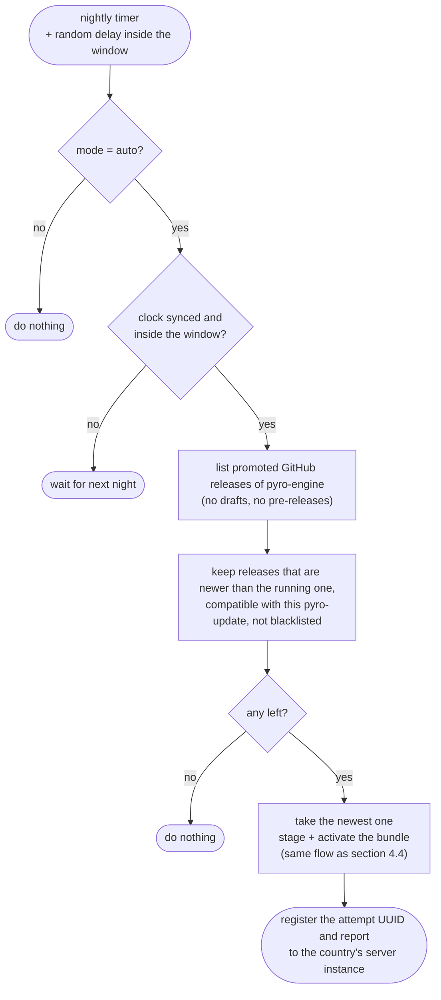

Rules:

- **Never `:latest`.** Only a promoted release counts, and the Pi resolves it to image digests.
- **Newest eligible release**, not "latest release": the Pi filters first (promoted, newer, compatible, not blacklisted), then takes the newest one.
- **Blacklist.** A release that failed its health check on this Pi is never retried by the timer. A push of the same release clears it.
- **Auto attempts have no job.** The Pi creates the attempt UUID itself and registers it with its report.
- **Random delay inside the window**, never beyond the latest activation time.

Interaction with push:

- A push to an `auto` Pi switches it to `pinned` on the pushed version.
- **Summer freeze:** switch a group to `pinned` in one click. A mode-only change keeps the version currently running. The Fleet API stores the **requested** mode and the mode **acknowledged** by the Pi, and shows the freeze as **incomplete** until every Pi has acknowledged it. An offline Pi in auto mode can still update itself until it comes back online; that is accepted, because it only takes promoted releases.

## 6. Updating the server VMs

One VM can run several independently versioned services (`deploy-combined` installs alert API, platform, mediamtx and traefik on one host). A VM deployment therefore targets **one service on one host**, with a host lock so two jobs never touch the same VM at the same time.

Server updates run as scheduled jobs in a night window, from the country's server instance (not from a laptop that may be off at midnight).

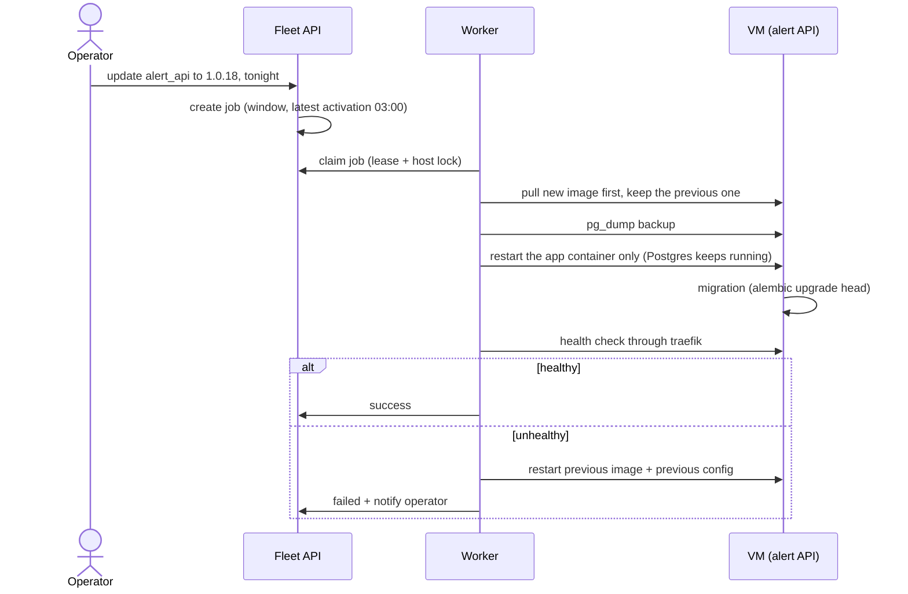

This needs a **dedicated app-update path**, not the current playbooks:

- `alert_api` and `platform_react` start with `state: absent` and `remove_images: all`. For `alert_api` this also stops Postgres, which lives in the same compose project (the platform has no database).
- `deploy-servers.yml` also installs the VPN and reboots the machine. That has no place in a nightly app update.
- The API runs `alembic upgrade head` at startup, so restarting the previous image does not undo a schema change. **Migrations must be backward compatible**: release N-1 must still run on the schema of release N. A migration that cannot follow this rule is deployed by hand, outside the night window. The `pg_dump` taken before the update is the last resort.

## 7. Security and prerequisites

- **Host identity.** The SSH host key of each Pi is **enrolled at station setup** (station setup wizard), not learned from whatever answers on a VPN IP. A changed key (reinstalled Pi) requires an explicit re-enrollment. The worker forces strict host key checking regardless of `ansible.cfg` (which currently sets `host_key_checking = False`). The guarantee "a wrong IP can never update the wrong station" only holds for correctly enrolled Pis.
- **Encryption key.** Losing the instance key makes every secret unreadable, even with a database backup. The key is backed up separately, restore is tested, each secret records the key id it was encrypted with, and a missing or wrong key makes the instance refuse to start with a clear error. Moving secrets from one instance to another (for example to a laptop) is an explicit export/import that decrypts and re-encrypts.
- **No secrets in logs.** Before any writable job: secret-bearing Ansible tasks use `no_log`, rendered files with secrets are `0600` (today the engine `.env` is `0644` and `check_vars` logs some secrets), and job logs and reports are redacted.
- **Credentials are separated.** Operator accounts can deploy. Report tokens can only report for their own Pi. Workers use scoped alert API accounts, not superadmin.
- **Pi to instance reachability.** Pis can reach a server instance on the VPN. For a laptop instance, the OpenVPN server must allow `client-to-client`, otherwise reports fall back to the attempt file read over SSH.
- **Running version.** Reported by `pyro-update` (section 4.5), so no change is needed in the engine or the alert API. Before `pyro-update` is installed on a Pi, the worker reads the running image digests over SSH (`docker inspect`).
- **No image tag from a branch name or `:latest`** in any deployment.
- **Detection never depends on the Fleet API.** If it is down, engines keep running.

## 8. Plan

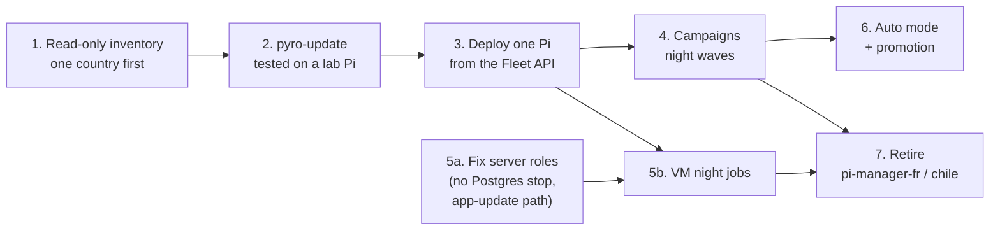

1. **Read-only inventory, one country first.** Import a country repo checkout into Postgres, with its source commit and the conflicts found (duplicate VPN IPs, cameras missing in the alert API). Create the camera bindings. Show declared pins next to observed versions (read over SSH with `docker inspect`, since `pyro-update` does not exist yet), with **unknown** when a Pi cannot be reached. The country repo stays the operational source during this step. Re-importing creates no duplicates.
2. **`pyro-update` on a lab Pi.** Bundle, activation, health check against a baseline, rollback, recovery at boot, attempt files. Test a power cut after each phase, including during rollback.
3. **Deploy one Pi from the Fleet API.** Ownership and lock, strict host key check, durable jobs, reports, secret handling.
4. **Campaigns.** Explicit lists of hosts, manual approval of the canary, night waves, stop on failure or unknown.
5. **Server VMs.** (a) Fix the `alert_api` and `platform_react` roles and write the app-update path; this can start right away. (b) Schedule VM updates in night windows, once durable jobs exist (step 3).
6. **Auto mode** with promotion.
7. **Retire `pi-manager-fr` and `pi-manager-chile`**, only once everything they are used for runs from the Fleet API:
   - Pi provisioning (`rpi-init`, `rpi-init-pi-zero`), Wi-Fi, static IP;
   - Pi Zero and Shelly watchdogs;
   - VPN certificates and reverse SSH;
   - mediamtx stream paths and `device_config`;
   - SSH key sync;
   - the station setup wizard, which today writes the country repo.

   A generated Ansible inventory is enough to run the remaining playbooks. There is no two-way sync between the database and the repos: until a feature is migrated, it stays in the repo.

The cleanup issues (#57, #58, #59, #61, #62, #18) are re-evaluated against this plan. Some become unnecessary once the country repos are retired; others (secrets in logs, `.env` modes, galaxy role pinning) are needed before step 3.

## 9. Kept simple on purpose

For a team of 2-3 people:

- **No distributed coordination protocol.** One owner instance per Pi, a local lock and an attempt UUID cover concurrent instances.
- **No message queue.** Jobs live in Postgres, claimed with a lease.
- **No configurable rollout strategies.** Waves are explicit host lists, one per night.
- **No automatic database downgrade.** Backward-compatible migrations and a `pg_dump` before each update.
- **No large frontend** before steps 1 to 3 are done.

## 10. Options considered

| Option | Why not (for now) |
|---|---|
| Keep Ansible + country repos, only clean up | Does not fix the duplicated sources of truth or the missing version view. |
| Pull agent on every Pi | Pis must reach the Fleet API at all times, which breaks local instances. We keep the door open: auto mode already uses the same script on a timer. |
| Semaphore / AWX | Runs Ansible, but has no model of stations, versions or rollouts. We would build that part anyway. |
| Mender / balena / Yocto | OS-level change, out of scope for now. |
| Watchtower | Updates on every new image, with no window, no waves and no rollback. Upstream is archived. |
