# Fleet API: one service to configure, version and deploy stations and servers

- **Status:** Proposed
- **Deciders:** Mateo
- **Date:** November 2026
- **Issue:** pyronear/pi-manager-template#109 (epic pyronear/roadmap#14)
- **Supersedes in part:** `Mender vs Ansible` (Ansible stays, but it is driven by the Fleet API)

## 1. Context

Today a deployment is: edit YAML in a private country repo (`pi-manager-fr`, `pi-manager-chile`), then run an Ansible playbook from a laptop inside the `pyro-ansible` container.

The same station is described in four places that drift apart:

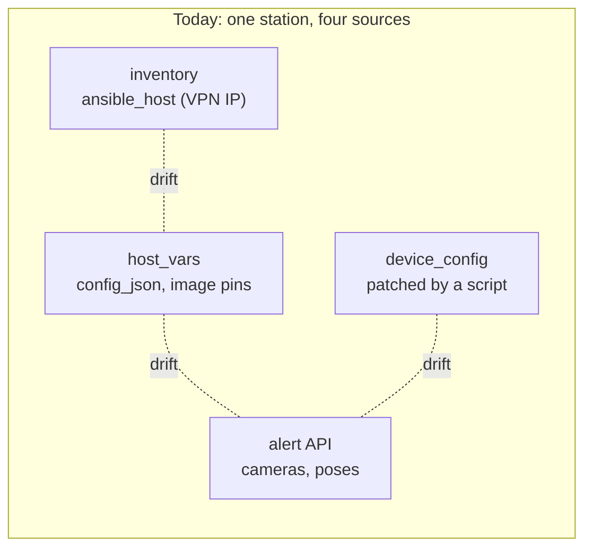

Incidents caused by this drift:

- a camera in `config_json` that does not exist in the API (snow-valley);
- inventory entries pointing at another site's Pi after the VPN renumbering;
- image pins in `host_vars` wiped by a `git reset`;
- `device_config` applied by hand.

Other problems:

- Nobody can tell which version runs on which station.
- Deployments are slow and manual.
- During fire season, server updates must not cut the service during the day.

## 2. Decision

We build a custom **Fleet API** (FastAPI + Postgres) with a small frontend and a worker that runs the existing Ansible roles.

| Topic | Decision |
|---|---|
| Source of truth | Read as much as possible from the **alert API** (cameras, poses, engine heartbeat). The Fleet API stores only what the alert API does not have. |
| Secrets | Stored **encrypted in the database**, with a key per instance (env var). Never returned in clear by the API or the frontend. |
| Security | Reachable through the VPN only, with authentication and an audit log of every action. |
| Instances | **One instance per country** (France, Chile, ...). Anyone can also run one **locally** with the same `docker compose`. |
| Execution | **Ansible stays.** The roles in this repo are embedded in the worker image. |
| Update model | **Push** to decide, **local execution** on the Pi (`pyro-update`), plus an optional **auto mode** to catch up. |
| Tooling | Custom. No Semaphore, AWX, Mender or Yocto for now. |

Consequences:

- `pi-manager-template` becomes this product.
- `pi-manager-fr` and `pi-manager-chile` are imported into their instance's database, then retired.

## 3. Architecture

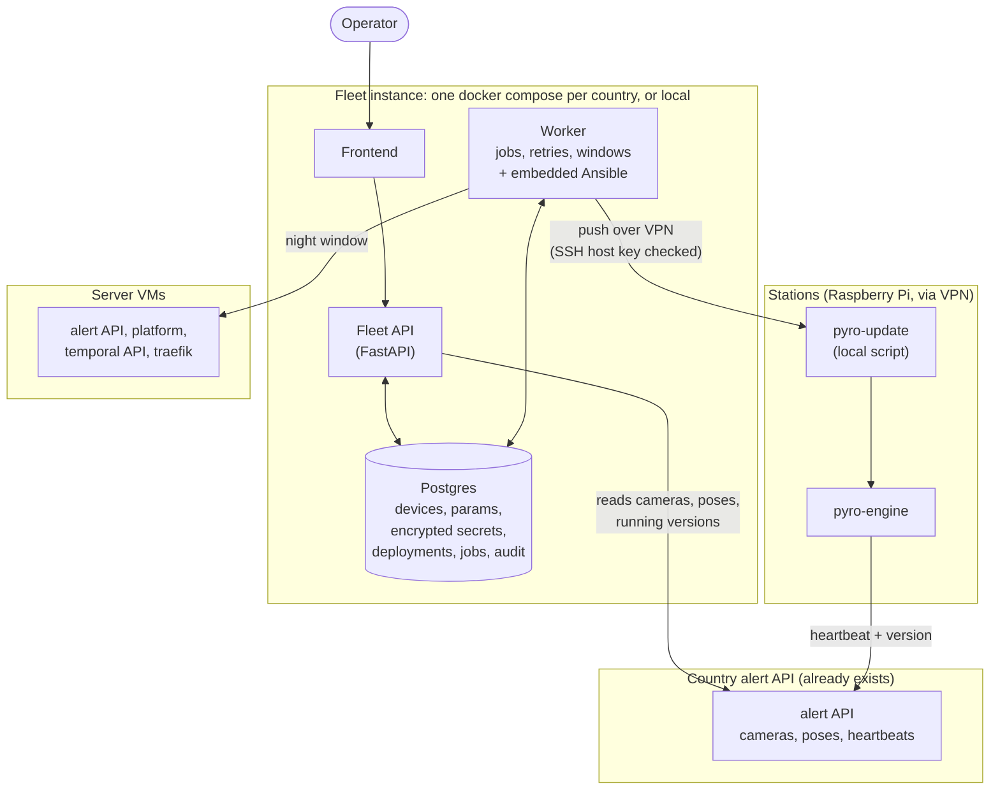

Two key points:

- **Decisions go down by push** (worker → Ansible → Pi).
- **What actually runs comes back up through the engine heartbeat** to the alert API. A deployment that "succeeded" is never used as proof of the running version.

### What lives where

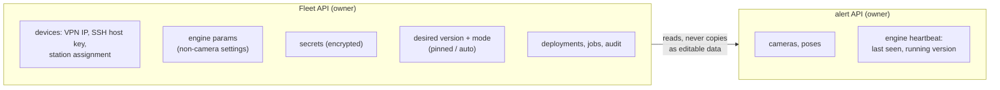

### Data model (first sketch)

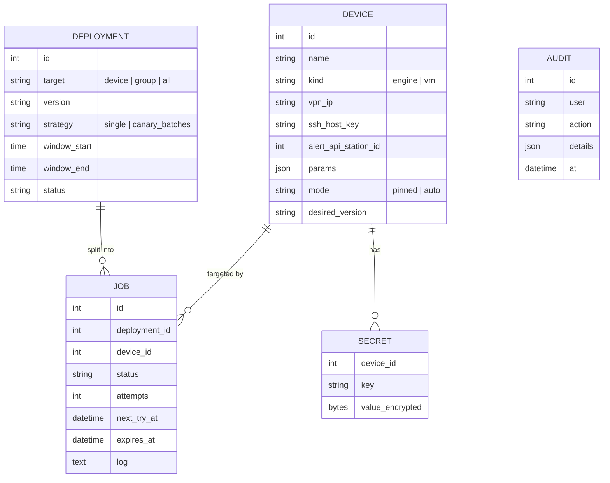

## 4. Updating an engine

### 4.1 Push, then local execution

The worker does not stay connected during the update. It drops `pyro-update` and the target version on the Pi, then starts it detached (`systemd-run`). If 4G drops in the middle, the Pi still finishes or rolls back on its own.

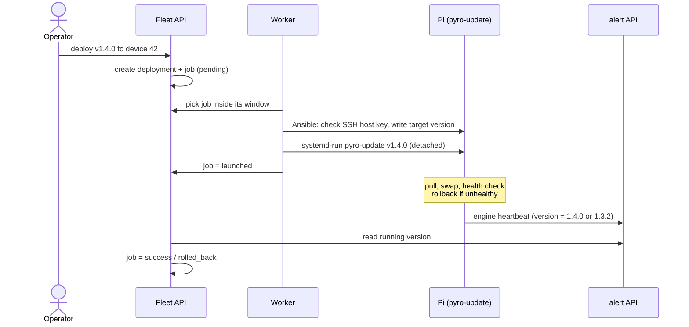

### 4.2 What `pyro-update` does on the Pi

Everything that is needed to roll back (image, compose file, config, scripts) is kept locally before the working engine is touched.

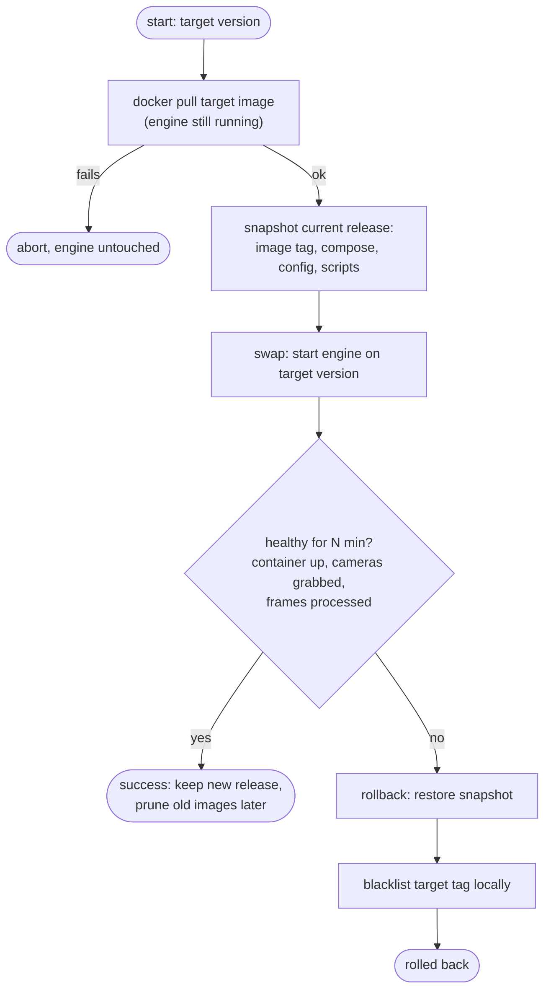

The health check must not depend on the alert API alone. If the country API is down, that is not a reason to roll back an engine.

### 4.3 Jobs: retries, windows, deadlines

Offline Pis are a normal state. A job waits for its device instead of failing.

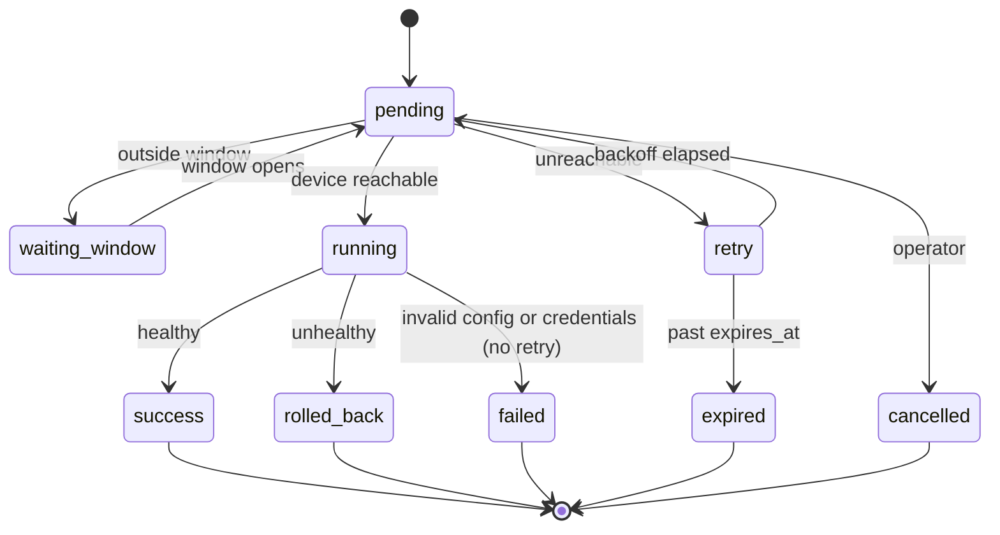

Rules:

- **One job at a time per device.**
- **A late job never starts outside its window.** A job planned for midnight that is still pending at 6:00 waits for the next window, or expires.
- **Errors that cannot be fixed by waiting** (bad config, bad credentials) are not retried.

### 4.4 "Update all" means waves

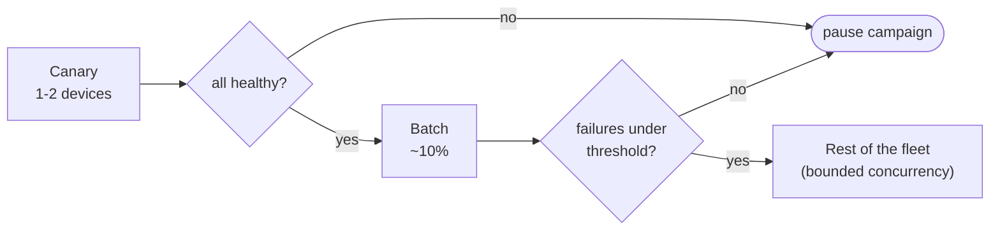

The operator can pause or cancel a campaign at any time.

## 5. Auto mode

Each device has a mode, stored in the Fleet API and written to the Pi by Ansible:

| Mode | Behaviour |
|---|---|
| `pinned: vX.Y.Z` | The nightly timer does nothing. Only a push changes the version. |
| `auto` | Every night, the Pi updates itself to the latest stable release, with the safeguards below. |

Auto mode is a systemd timer that runs `pyro-update --auto`. It lets a Pi that was offline for a long time catch up, even if no Fleet instance is running (for example a local instance on a laptop that is switched off).

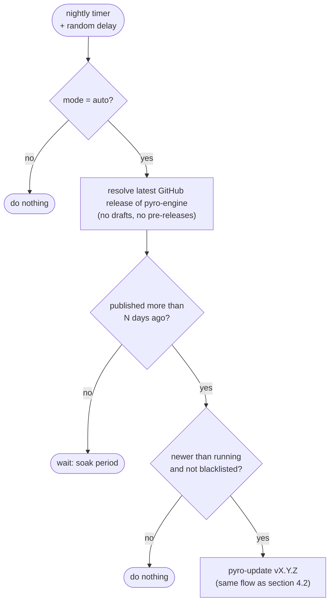

Safeguards:

- **Never `:latest`.** It is overwritten on every merge to `main`. Only a published release counts, and the script logs the exact tag and digest.
- **Soak period** (for example 3 days). Pinned devices and pre-releases act as canaries before a release reaches auto devices.
- **Local blacklist.** A tag that failed its health check is never retried by the timer.
- **Random delay**, so that every Pi does not pull at the same minute over 4G.

Interaction with push:

- A push to an `auto` device switches it to `pinned`.
- **Summer freeze:** switch a group to `pinned` in one click. The Fleet API pushes the new mode without changing the version.

## 6. Updating the server VMs

Server updates (alert API, platform) run as scheduled jobs in a night window, from the country's server instance (not from a laptop that may be off at midnight).

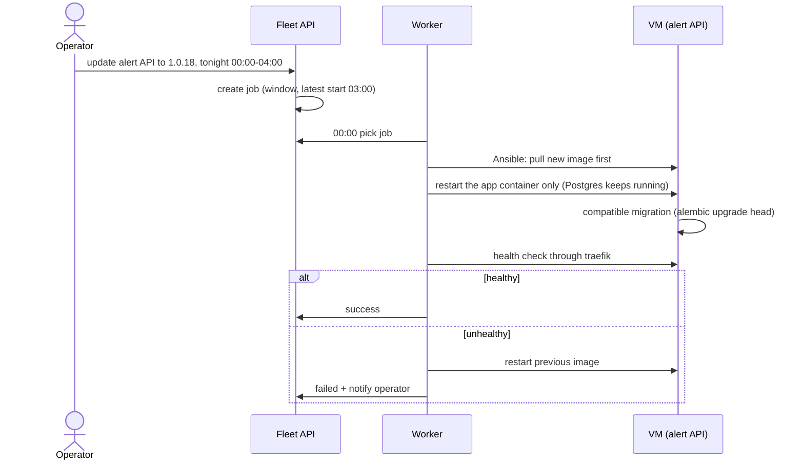

This needs a change in the current roles. `alert_api` and `platform_react` start with `state: absent` and `remove_images: all`, which also stops Postgres. Restarting an old image does not undo a schema migration either, so migrations must stay backward compatible.

## 7. Prerequisites and known limits

- **Device identity.** Ansible runs with `host_key_checking = False`. The Fleet API stores each device's SSH host key and generates `known_hosts` for every job, so a wrong IP can never update the wrong station.
- **Running version.** Check whether the engine heartbeat already sends its version to the alert API. If not, it is a small change in the engine and the alert API.
- **Server roles.** Rewrite `alert_api` and `platform_react` so that an update never stops Postgres (section 6).
- **Local instance.** Scheduled jobs only run while the machine is on. Production night windows must run on a server instance.
- **No image tag from a branch name or `:latest`** in any deployment.
- **Detection never depends on the Fleet API.** If it is down, engines keep running.

## 8. Plan

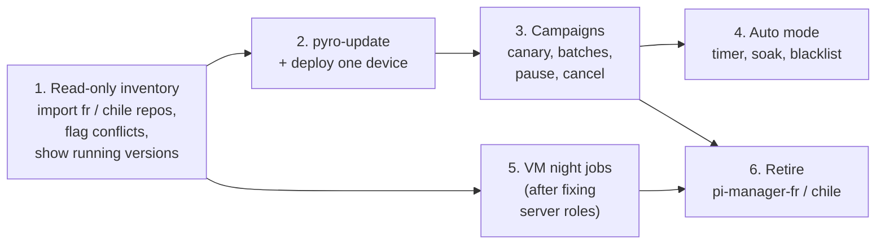

The cleanup issues (#57, #58, #59, #61, #62, #18) are re-evaluated against this plan: some become unnecessary once the country repos are retired, others (secrets in logs, `.env` modes) are still needed first.

## 9. Options considered

| Option | Why not (for now) |
|---|---|
| Keep Ansible + country repos, only clean up | Does not fix the duplicated sources of truth or the missing version view. |
| Pull agent on every Pi | Pis must reach the Fleet API at all times, which breaks local instances. We keep the door open: auto mode already uses the same script on a timer. |
| Semaphore / AWX | Runs Ansible, but has no model of stations, versions or rollouts. We would build that part anyway. |
| Mender / balena / Yocto | OS-level change, out of scope for now. |
| Watchtower | Updates on every new image, with no window, no waves and no rollback. Upstream is archived. |
